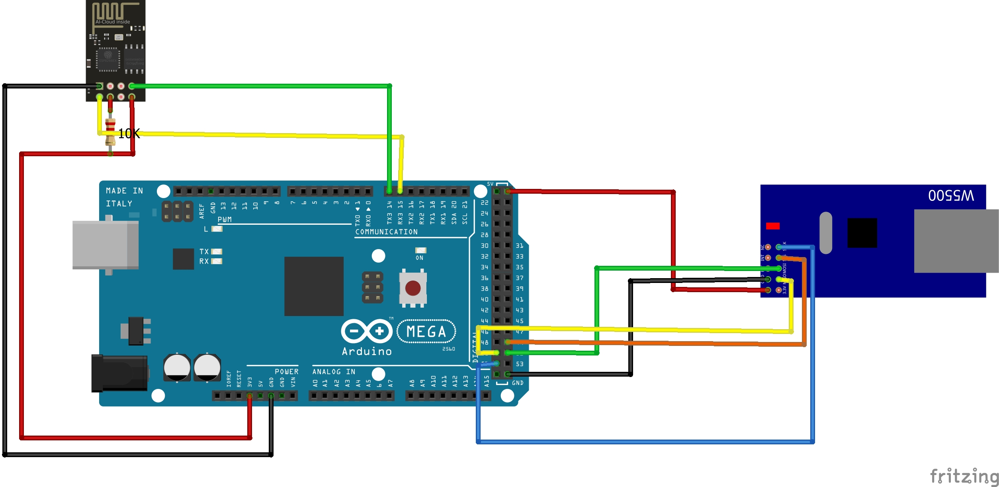
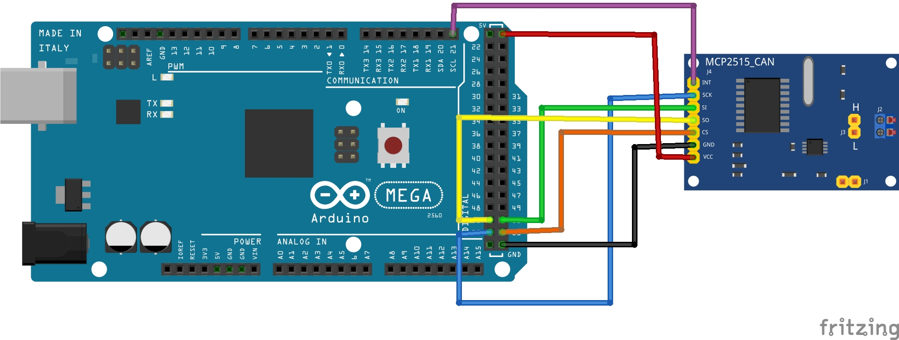
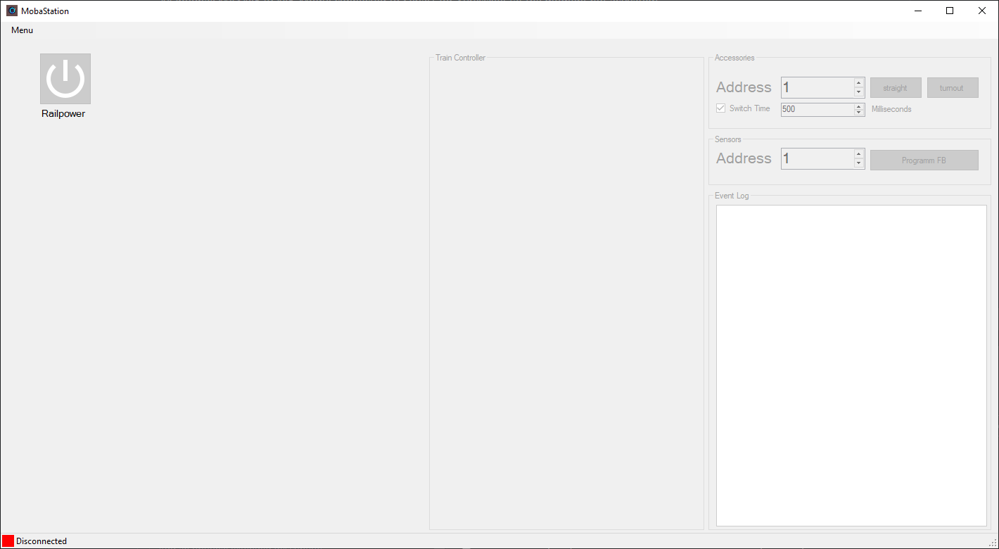
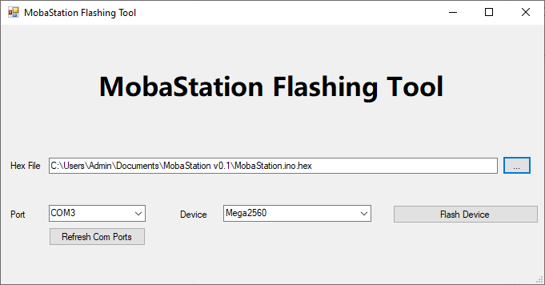
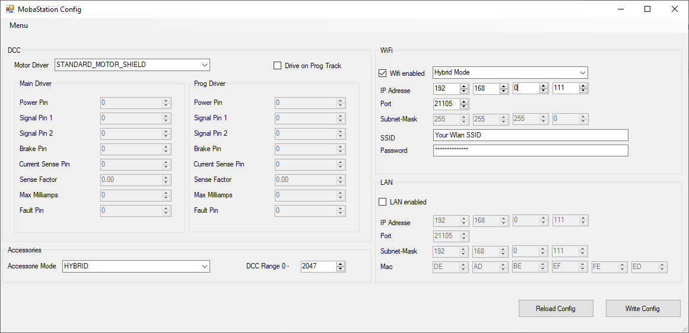

# MobaStation
[](https://github.com/Maggge/MobaStation/actions/workflows/ci.yml)

<p align="center">
  
  
</p>

MobaStation is a open source project to create a full digital model railroad control system based on Arduino.
Main goal of the project is to use only cheap, easy to get components that can easy assembled.

MobaStation works with the Z21-LAN-Protocol. So you can connect it as Z21 to control systems like rocrail, traincontroller (not tested yet) and others. You can also use mobile-apps like the official Z21 app.

For DCC we use the <a href="https://github.com/Maggge/DCC">Maggge/DCC</a>-Library wich is extracted from <a href="https://github.com/DCC-EX/CommandStation-EX">DCC-EX</a>-Library and slightly modified.

For accessories like turnouts, sensors and others we use the <a href="https://github.com/Maggge/MobaBus">Maggge/MobaBus</a>-Library.</br>
XpressNet is supported as well, connect a MAX485 RS485 module to Serial1 (TX1/RX1) and drive the direction pin with pin 22 to use Roco multiMAUS or Lenz throttles.

<h2>Build it yourself</h2>

The repository is an Arduino library, the sketches in <i>examples</i> are the supported build targets.
MobaStation needs the DCC and MobaBus libraries, both are plain git repositories without a
library.properties file, so they have to be cloned into the libraries folder of your Arduino sketchbook:

```
git clone https://github.com/Maggge/DCC       ~/Arduino/libraries/DCC
git clone https://github.com/Maggge/MobaBus   ~/Arduino/libraries/MobaBus
```

Install the remaining libraries (Ethernet, Servo, mcp_can and the Adafruit PWM Servo Driver) with the
library manager of the IDE, or with arduino-cli:

```
arduino-cli lib install Ethernet Servo mcp_can "Adafruit PWM Servo Driver Library"
arduino-cli compile --fqbn arduino:avr:mega --library . examples/MobaStationEth
```

Copy MobaStationConfig.example.h to MobaStationConfig.h in the folder of the MobaStation library if you
want to change the pins or the default settings without editing the library.

<h3>Development with make</h3>

The Makefile wraps arduino-cli. The DCC and MobaBus libraries are used directly from their git
checkouts next to this repository (../DCC and ../MobaBus), so changes there are compiled in without copying.

```
make setup                     # AVR core, libraries, clones DCC and MobaBus, creates MobaStationConfig.h
make build                     # compile examples/MobaStationWiFi
make upload                    # compile and flash (PORT=/dev/ttyUSB0)
make monitor                   # serial console, exit with Ctrl+C
make log                       # serial output of the first 20 seconds after a reset
make z21test                   # Z21 LAN selftest against Z21_IP (192.168.30.111)
make upload SKETCH=examples/MobaStationEth PORT=/dev/ttyUSB1
```

All settings (WiFi, IP or DHCP, motor shield, MobaBus, XpressNet) are in MobaStationConfig.h, the sketches need no changes.
MobaBus modules only get turnout commands above `DCC_TURNOUT_ADDRESS_RANGE` (default 2047 = all turnouts are DCC),
set it eg. to 1000 for DCC decoders 1-1000 and MobaBus from 1001.

MobaBus modules are configured with "POM accessory" (CV programming on the main for accessory decoders), eg.
`python3 extras/z21test.py 192.168.30.111 cv 1020 33 50` sets CV33 of the module at address 1020 and reads it back.
The CVs are described in the README of MobaBus.

`examples/MobaStationEffects` runs MobaBus light effects (house with TV, candle, level crossing) on free pins of the Mega,
without CAN bus. `make upload EXTRA_FLAGS=-DMOBASTATION_LOOP_STATS` prints the loop time every 10 seconds.
`extras/z21test.py IP info|power on|loco 3 40|turnout 5 1|listen` sends single Z21 commands.

<h3>ESP8266 firmware with web interface</h3>

Instead of the AT firmware the ESP8266 of a Mega + WiFi R3 board can run its own firmware
(`extras/esp/MobaStationESP`, Mega sketch `examples/MobaStationESP`). The ESP does WiFi, the Z21 UDP port and a web
interface, the Mega exchanges Z21 packets with it in short frames over Serial3 instead of AT commands. This saves
about 2 KB of RAM on the Mega and the AT handshake for every packet.

The web interface (address of MobaStation in the browser) shows the track state, currents and voltage, switches
the track power and turnouts, changes the settings of the command station, finds MobaBus modules and reads and writes
their CVs, configures the WiFi and updates the ESP firmware. WiFi settings saved there win over MobaStationConfig.h,
without router the ESP opens its own access point (`WIFI_AP_SSID`, captive portal).

```
make esp-setup                 # once: ESP8266 core and libraries
# DIP switches 5-7 ON, others OFF, unplug and plug in the board
make esp-info                  # check chip and flash size (4 MB)
make esp-backup                # save the AT firmware to extras/esp/backup
make esp-upload                # flash the MobaStation ESP firmware
# DIP switches 1-4 ON, 5-8 OFF, unplug and plug in the board
make upload SKETCH=examples/MobaStationESP
make esp-ota                   # later updates of the ESP over WiFi
make esp-restore BACKUP=extras/esp/backup/<file>.bin   # back to the AT firmware
```

The <a href=https://github.com/Maggge/MobaStation/releases>releases</a> contain prebuild firmware plus the Config Tool,
so building it yourself is only needed if you want to modify something.

<h2>Installation</h2>

  1) Build the MobaStation:</br>
      1)For Network connectivity are different possibilities:
        - <a href="https://www.makershop.de/plattformen/arduino/mega2560-wifi-r3"/>Arduino Mega with integrated Wifi-Module </a>(the ESP needs to  be flashed with the AT 1.7 firmware)
        - Arduino Mega with ESP-01 connected to Serial3 (the ESP needs to  be flashed with the AT 1.7 firmware)
        - Arduino Mega with Ethernet Modul
        - Arduino Mega with Ethernet and Wifi (the ESP needs to  be flashed with the AT 1.7 firmware)
        <p align="center">
           
        </p>
                 
      2)Arduino Motorshield for DCC      
    
      3)Optional: MCP2515 Can-Bus-Modul for MobaBus  
      <p align="center">
         
      </p>
      4)Optional: MAX485 RS485-Modul connected to Serial1 for XPressNet (direction control on pin 22)
      <p align="center">
         
      </p>
      5)Optional: Track-Power-Button (connected to Pin 24 and GND) and Track-Status-Led (connected to Pin 25 and GND). I use a Button with integrated LED-Ring
      6)Optional: Track-Voltage meter (Voltage divider on MotorDriver Input. Connected to Pin A15. Resistor - values will follow).
      
  
  2) Download the latest <a href=https://github.com/Maggge/MobaStation/releases>Release<a> (not the source code!) and extract it. 
  3) Connect the Arduino Mega to USB.
  4) Open the MobaStation Config Tool.
    <p align="center">
       
    </p>
  5) Open "Flash device" in Menu.
    <p align="center">
       
    </p>
  6) Select the COM Port of the Arduino and the firmware contained in Package and "Flash device".
  7) Now you can connect to MobaStation in Menu
  8) Open the config window in Menu.
    <p align="center">
       
    </p>   
   8) Enter your settigns. Press "Write config" and voilà. Your MobaStation is now ready to drive your trains!
