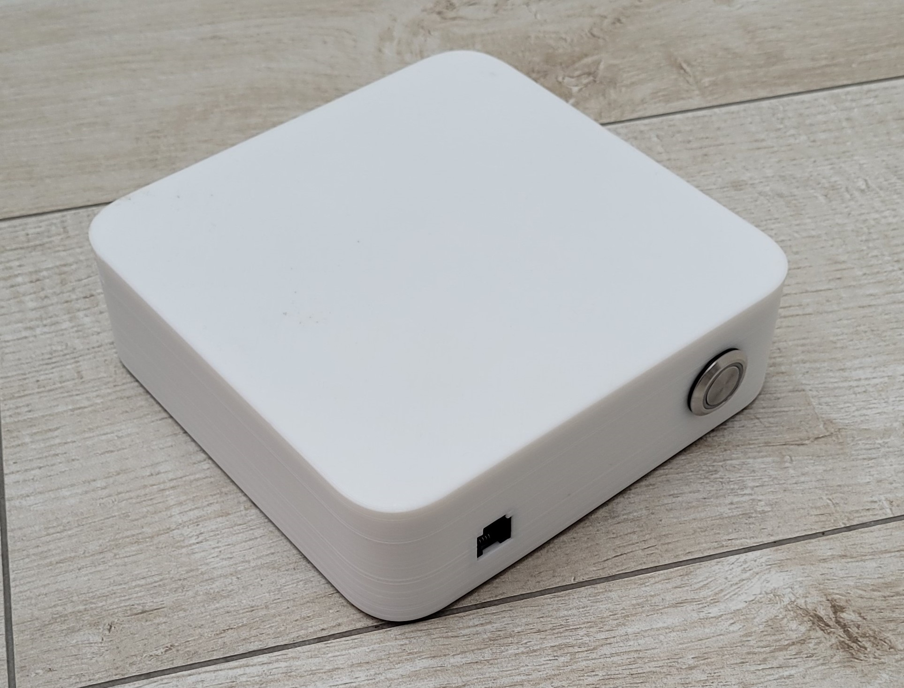
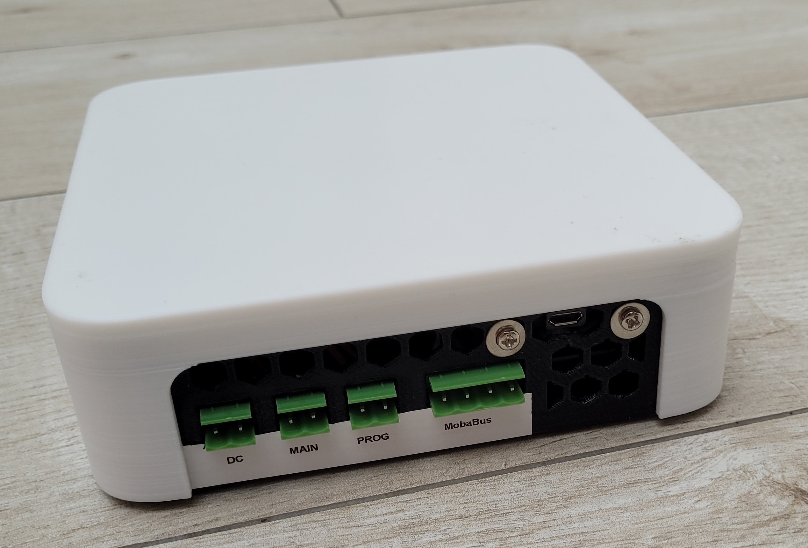
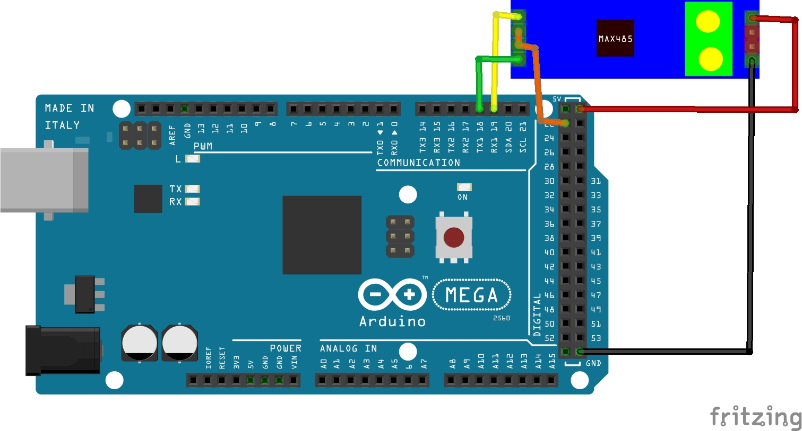
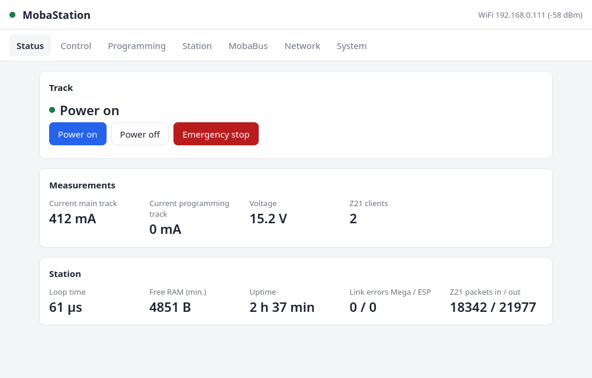
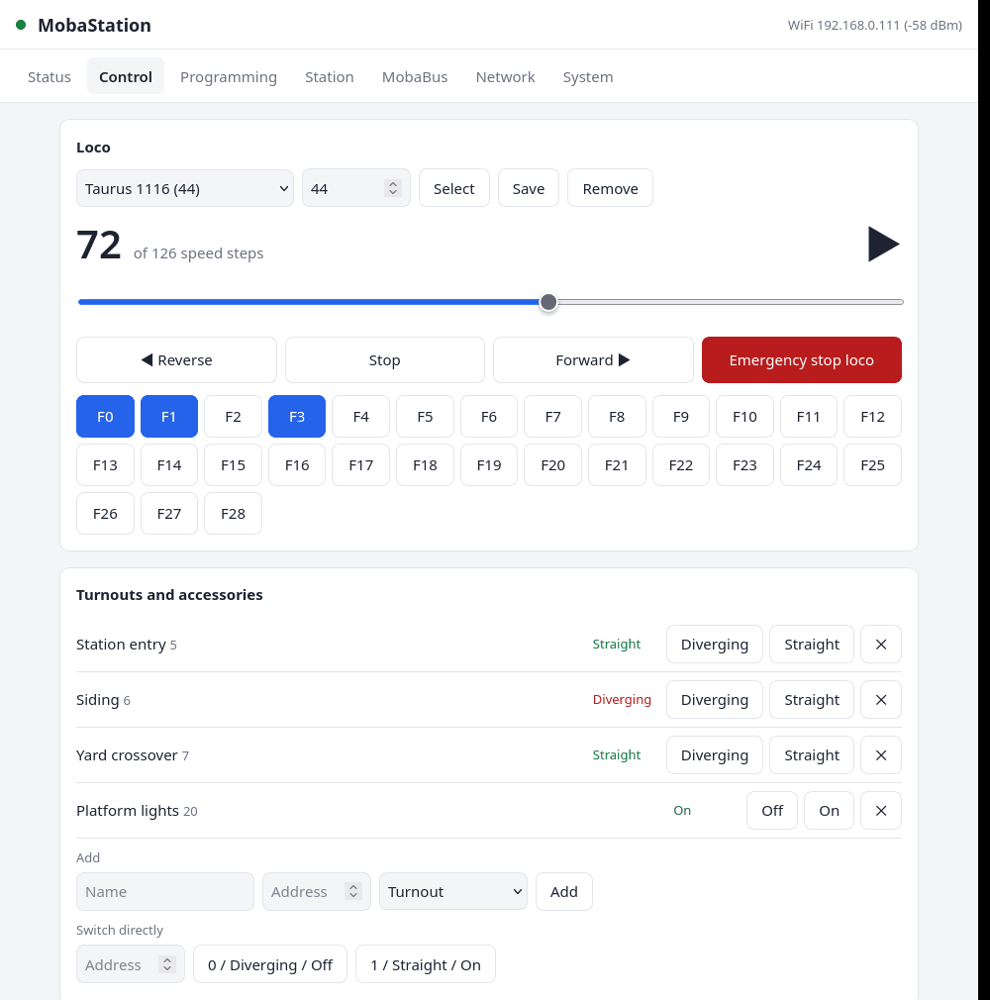
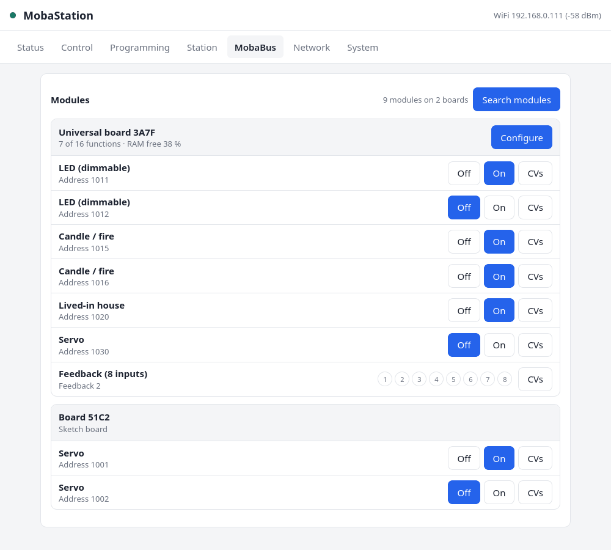
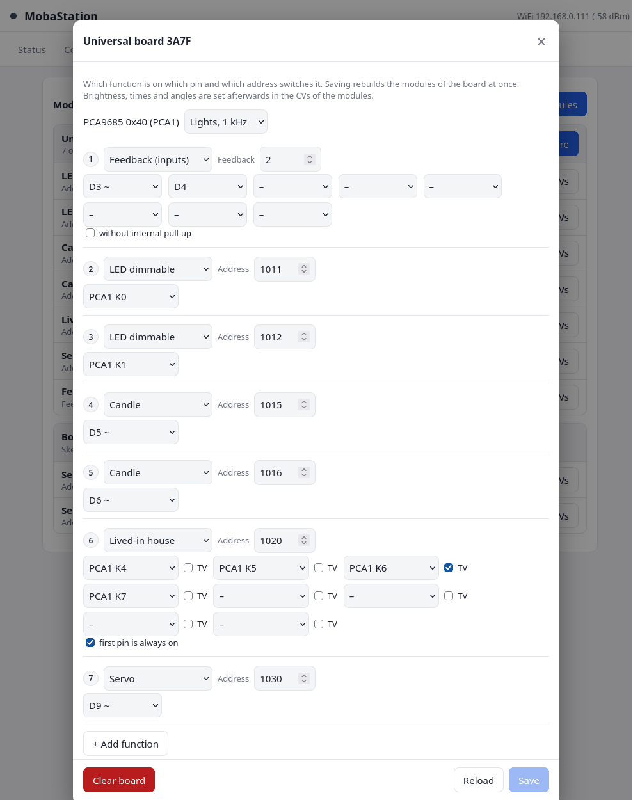
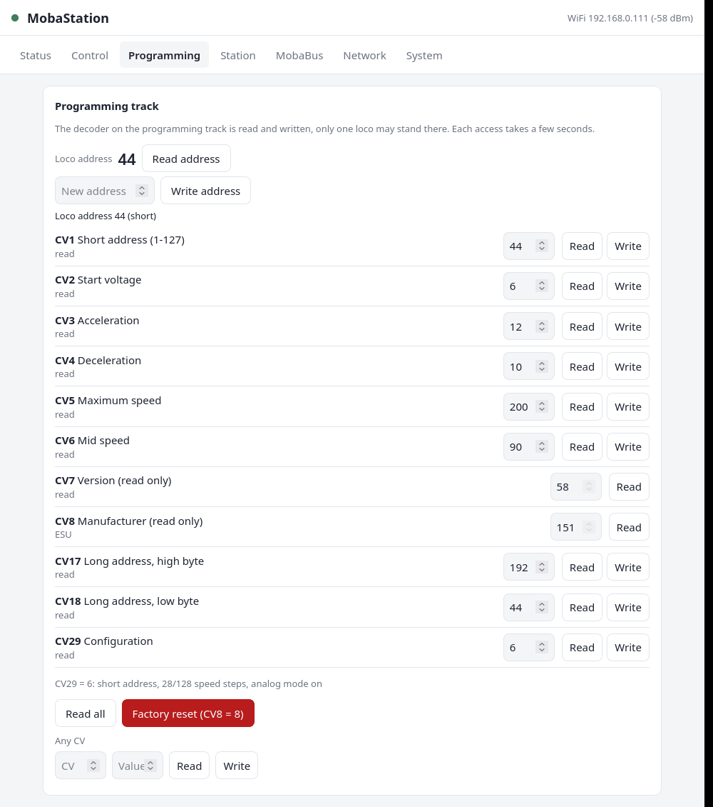
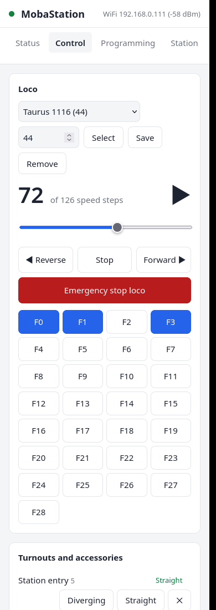

# MobaStation
[](https://github.com/Maggge/MobaStation/actions/workflows/ci.yml)

<p align="center">
  
  
</p>

MobaStation is an open source digital command station for model railroads, built from cheap parts that are easy to get:
an Arduino Mega, the Arduino Motor Shield and an ESP8266 for WiFi.

- **Z21 LAN protocol**: use the Z21 app, Rocrail, TrainController and other Z21 compatible software.
- **DCC** for locos and turnouts, with a programming track. It uses the [Maggge/DCC](https://github.com/Maggge/DCC)
  library, which is extracted from [DCC-EX](https://github.com/DCC-EX/CommandStation-EX).
- **MobaBus** (optional, CAN bus): turnouts, servos, lights and feedback modules on Arduino Nano boards, see
  [Maggge/MobaBus](https://github.com/Maggge/MobaBus).
- **XpressNet** (optional, RS485): Roco multiMAUS and Lenz throttles.
- **Web interface** in the browser, on the phone too, in English or German: drive locos, switch turnouts, program
  decoders, set up the MobaBus modules and the network.

Nothing has to be configured before flashing. After the first start MobaStation opens its own WiFi access point,
and everything else is set up in the web interface.

## Parts

| Part | Notes |
|---|---|
| Arduino Mega 2560 with ESP8266 | Either a Mega + WiFi R3 board (eg. Wemos/RobotDyn "Mega2560 + ESP8266"), or a normal Mega with a separate ESP8266 board. A Wemos D1 mini or a NodeMCU is best: 4 MB flash and a USB port to flash it. |
| Arduino Motor Shield Rev3 | Channel A drives the main track, channel B the programming track. |
| Power supply | 12-18 V DC for the track. |
| MCP2515 CAN module, 8 MHz crystal | Optional, for MobaBus. |
| MAX485 RS485 module | Optional, for XpressNet. |
| Push button with LED | Optional, switches the track power. |
| 2 resistors | Optional, for measuring the track voltage. |

## Wiring

**Motor Shield.** Plug it onto the Mega and connect the power supply to the screw terminal of the shield. Connect the
main track to A+/A- and the programming track to B+/B-. The shield also feeds the Mega through Vin. With a supply above
12 V, cut the "Vin Connect" jumper on the back of the shield and power the Mega from its own jack.

**ESP8266.** It talks to the Mega over Serial3.

- **Mega + WiFi R3 board:** the ESP is already on the board. For normal operation set DIP switches 1-4 ON and 5-8 OFF,
  and set the serial selector to RXD3/TXD3.
- **Separate ESP8266**, eg. a D1 mini:

  | ESP | Mega |
  |---|---|
  | 5V | 5V |
  | GND | GND |
  | TX | RX3 (pin 15) |
  | RX | TX3 (pin 14), through a voltage divider (1 kΩ from TX3 to RX, 2 kΩ from RX to GND), because the ESP takes only 3.3 V |

  An ESP-01 also works. It needs its own 3.3 V regulator, because the 3.3 V pin of the Mega delivers too little
  current, and EN/CH_PD must be tied to 3.3 V. It has only 1 MB of flash, so the ready-made firmware does not fit.
  Build it yourself with `make esp-upload ESP_FQBN=esp8266:esp8266:generic:eesz=1M64`. Updates over WiFi don't
  work with 1 MB.

**Optional parts.**

| Part | Wiring |
|---|---|
| MCP2515 (MobaBus) | VCC 5V, GND, CS → 53, SO → 50, SI → 51, SCK → 52, INT → 21. The CAN bus runs at 125 kbit/s. Without a module MobaBus switches itself off. |
| MAX485 (XpressNet) | RO → RX1 (19), DI → TX1 (18), DE and RE → 22, A/B to the XpressNet. |
| Track power button | Pin 24 to GND. LED with a resistor: pin 25 to GND. |
| Track voltage | Voltage divider from the track supply to A15, eg. 47 kΩ to A15 and 10 kΩ from A15 to GND. Calibrate the factor on the page "Station". |

<p align="center">
  
  
</p>

The STL files of the housing are in [Housing](Housing). `Cover_Xpress.stl` has an opening for the XpressNet socket.

## Flashing

Both the Mega and the ESP8266 get a firmware, and nothing has to be configured before. The ready-made files are
attached to every [release](https://github.com/Maggge/MobaStation/releases/latest):

| File | For |
|---|---|
| `MobaStation-Mega.hex` | Arduino Mega 2560, also the Mega of a Mega + WiFi R3 board |
| `MobaStation-ESP8266.bin` | ESP8266 with 4 MB flash: the ESP of a Mega + WiFi R3 board, Wemos D1 mini, NodeMCU |

To build them yourself instead, see [Building it yourself](#building-it-yourself).

### Tools

- **avrdude** for the Mega. Linux: `sudo apt install avrdude` or `sudo dnf install avrdude`. macOS:
  `brew install avrdude`. Windows: unpack `avrdude-…-windows-x64.zip` from the
  [avrdude releases](https://github.com/avrdudes/avrdude/releases).
- **esptool** for the ESP: `pip install esptool` (Python 3). Without installing anything, the
  [ESP web flasher](#esp-web-flasher) in Chrome or Edge works too.

Replace `PORT` in the commands with the serial port of the board: `/dev/ttyUSB0` or `/dev/ttyACM0` on Linux,
`/dev/cu.usbserial-…` on macOS, `COM3`, `COM4`, … on Windows (see the Device Manager).

### Mega

Connect the Mega by USB. On a Mega + WiFi R3 board the DIP switches stay in the normal position: 1-4 ON, 5-8 OFF.

```
avrdude -p atmega2560 -c wiring -P PORT -b 115200 -D -U flash:w:MobaStation-Mega.hex:i
```

avrdude ends with "… bytes of flash verified".

### ESP8266 on a Mega + WiFi R3 board

The ESP is flashed through the USB port of the board.

1. Set DIP switches 5, 6 and 7 ON and all others OFF. Unplug the board and plug it in again: the ESP now waits in its
   boot loader.
2. Flash it:

   ```
   esptool --port PORT --baud 460800 --before no-reset --after no-reset write-flash --erase-all 0x0 MobaStation-ESP8266.bin
   ```

   `--erase-all` clears everything on the ESP first, eg. the AT firmware the board comes with. Leave it out for an
   update that should keep the WiFi settings.
3. Set DIP switches 1-4 ON and 5-8 OFF again. Unplug the board and plug it in again.

### Separate ESP8266 (D1 mini, NodeMCU)

Disconnect it from the Mega and connect it by its own USB port. It switches into its boot loader by itself:

```
esptool --port PORT --baud 460800 write-flash --erase-all 0x0 MobaStation-ESP8266.bin
```

Then connect it to the Mega again, see [Wiring](#wiring).

### ESP web flasher

Instead of esptool, open the [ESP web flasher](https://espressif.github.io/esptool-js/) in Chrome or Edge:

1. On a Mega + WiFi R3 board, set the DIP switches as in step 1 above first.
2. Baudrate 460800, "Connect", choose the port.
3. "Erase Flash" for a clean start (deletes the WiFi settings).
4. Flash address `0x0`, choose `MobaStation-ESP8266.bin`, "Program".
5. On a Mega + WiFi R3 board, set the DIP switches back as in step 3 above.

### Updates

- **ESP:** no cable needed. On the page System of the web interface, choose the new `MobaStation-ESP8266.bin` and
  press "Update". The WiFi settings stay.
- **Mega:** flash the new `MobaStation-Mega.hex` as above. The settings in its EEPROM stay.

The firmware version is shown on the page System.

## First start

1. Power the MobaStation. The ESP opens the WiFi access point **MobaStation** with the password **MobaStation**.
2. Join it with your phone or laptop. The web interface opens by itself, otherwise browse to **http://192.168.0.111**.
   This is also the address the Z21 app uses by default, so you can drive right away.
3. On the page **Network**:
   - Enter the name and the password of your WiFi.
   - Choose DHCP or a fixed address. A fixed address in your home network is easiest for the Z21 apps; you can also
     reserve one in the router.
   - Change the password of the access point; the default password is public.
   - Save. The ESP connects to your router and can then be reached at the new address, or at http://mobastation.local.
4. If the router can't be reached for 20 seconds, the access point comes back, so you can always get in again.
5. On the page **Station**, set the turnout mode (DCC, MobaBus or both) and the track voltage factor. These settings are
   stored in the EEPROM of the Mega.

## Web interface

The language follows the browser (German for German browsers, English for all others) and can be switched on the page
System.

| Page | What it does |
|---|---|
| Status | Track state, track power and emergency stop, currents, voltage, Z21 clients, loop time and free RAM of the Mega. |
| Control | Drive a loco (speed, direction, functions), a list of saved locos, turnouts and accessories to switch. |
| Programming | Read and write the address and CVs of a loco decoder on the programming track, write CVs on the main (POM). |
| Station | Turnout mode and DCC range, voltage factor, track power after the start. |
| MobaBus | Finds all modules on the bus and shows their state: turnout or light on/off, and the 8 inputs of a feedback module live. Edits their CVs by name. Configures universal boards: which function on which pin, with address. |
| Network | WiFi, access point, IP or DHCP. |
| System | Firmware version, ESP update in the browser, restart, language, log. |

The web interface talks to the Mega like a Z21 app, so it works next to the Z21 app, Rocrail and a multiMAUS.

<p align="center">
  
  
</p>
<p align="center">
  
  
</p>
<p align="center">
  
  
</p>

## MobaBus

In the mode "Combined", turnout addresses up to the DCC range go out as DCC and the ones above to MobaBus. For example,
with a range of 1000, DCC decoders use addresses 1-1000 and MobaBus modules start at 1001.

Flash every Nano board with `examples/universal` of MobaBus. Then set it up on the MobaBus page with "Configure":
functions (LED, candle, house, servo, sensors, …), pins or PCA9685 channels, and addresses. Module CVs can also be
written with "POM accessory" from any Z21 software.

## Building it yourself

The repository is an Arduino library, and `examples/MobaStationESP` is the sketch for the Mega. `extras/esp/MobaStationESP`
is the ESP firmware. The Makefile wraps arduino-cli and uses the DCC and MobaBus libraries straight from their git
checkouts next to this repository (`../DCC`, `../MobaBus`):

```
make setup                     # AVR core and libraries, clones DCC and MobaBus
make esp-setup                 # ESP8266 core and libraries
make build / make upload       # Mega (PORT=/dev/ttyUSB0)
make esp-build / esp-upload    # ESP on a Mega + WiFi R3 board (DIP 5-7 ON), esp-ota updates it over WiFi (ESP_IP=...)
make esp-upload PORT=/dev/ttyUSB1 ESP_BEFORE=default-reset ESP_AFTER=hard-reset   # separate ESP (D1 mini)
make monitor                   # serial console of the Mega
make log                       # serial output of the first 20 seconds after a reset
make test                      # host tests on the PC, no board needed
make z21test Z21_IP=...        # Z21 LAN selftest against the station
```

The pins of the standard build are defaults in `src/MobaStation.h`. To change one, pass a define, eg.
`make upload EXTRA_FLAGS=-DPOWER_BUTTON=30`. `make upload EXTRA_FLAGS=-DMOBASTATION_LOOP_STATS` prints the loop time
every 10 seconds.

`extras/z21test.py IP info|power on|loco 3 40|turnout 5 1|cv 1020 33 50|listen` sends single Z21 commands.
